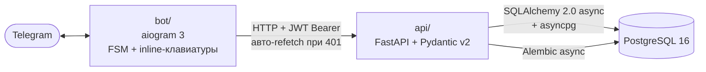

# Taskbot — Telegram-бот менеджера задач + FastAPI-бэкенд

[](https://github.com/s1lex312/taskbot/actions/workflows/ci.yml)
[](https://www.python.org/downloads/)
[](LICENSE)

Пет-проект, на котором я разбирался с JWT-аутентификацией между ботом и API и собирал aiogram 3 + FastAPI в одном репозитории. Бот — намеренно тонкий клиент: вся логика и данные живут в бэкенде, бот ходит в него по HTTP и не трогает БД напрямую. Заодно отработал нормальный пайплайн — миграции, тесты, линтеры, CI.

## Архитектура



- **api/** — REST API: routers → services → repositories → SQLAlchemy. JWT (`sub=user_id`, TTL 7 дней), изоляция данных по `owner_id`, единый JSON-формат ошибок.
- **bot/** — aiogram 3: FSM для создания проектов/задач, inline-клавиатуры, пагинация, `api_client` на httpx с кэшированием и автоматическим обновлением токена.

## Структура проекта

```
taskbot/
├── api/                     # FastAPI-бэкенд
│   ├── core/                # config, logging, security (JWT), dependencies
│   ├── db/                  # Base, engine, session factory
│   ├── models/              # User, Project, Task + enum'ы
│   ├── repositories/        # слой доступа к данным (owner-scoped)
│   ├── routers/             # auth, users, projects, tasks, health
│   ├── schemas/             # Pydantic-схемы
│   ├── services/            # бизнес-логика
│   ├── main.py              # приложение + обработчики ошибок
│   └── Dockerfile
├── bot/                     # aiogram-бот
│   ├── handlers/            # common, projects, tasks
│   ├── keyboards/           # inline-клавиатуры, эмодзи статусов
│   ├── middlewares/         # auth: инъекция per-user API-клиента
│   ├── services/            # api_client (httpx, JWT cache + refetch)
│   ├── states/              # FSM-формы
│   ├── main.py
│   └── Dockerfile
├── alembic/                 # async-миграции
├── tests/api/               # pytest: auth, projects, tasks, isolation
├── docker-compose.yml       # db + api + bot
├── Makefile                 # up / down / migrate / lint / test
└── pyproject.toml           # зависимости, ruff/black/isort/pytest
```

## Быстрый старт

```powershell
git clone https://github.com/s1lex312/taskbot.git
cd taskbot
Copy-Item .env.example .env   # затем вписать BOT_TOKEN и JWT_SECRET
make up                        # или: docker compose up --build -d
```

- API: http://localhost:8000 — Swagger UI на `/docs`, health-check на `/health`.
- Миграции применяются автоматически при старте контейнера `api`.
- Бот начинает polling сразу после старта — найди его по имени из BotFather и отправь `/start`.

> Если `make` не установлен: `scoop install make`. Все цели ниже имеют прямые эквиваленты команд.

### Переменные окружения (.env)

| Переменная | Назначение |
|---|---|
| `BOT_TOKEN` | токен бота от @BotFather |
| `DATABASE_URL` | async-URL SQLAlchemy (в compose подставляется автоматически) |
| `JWT_SECRET` | секрет подписи JWT (`python -c "import secrets; print(secrets.token_urlsafe(64))"`) |
| `JWT_ALG` / `JWT_EXPIRE_MINUTES` | алгоритм и TTL токена (по умолчанию HS256 / 10080) |
| `API_BASE_URL` | базовый URL API для бота |
| `SERVICE_KEY` | опционально: общий секрет для `POST /auth/telegram` (заголовок `X-Service-Key`); пусто = выключено |
| `POSTGRES_USER` / `POSTGRES_PASSWORD` / `POSTGRES_DB` | креды postgres для compose |
| `ENVIRONMENT` / `LOG_LEVEL` | окружение и уровень логов |

## API (префикс `/api/v1`)

Все эндпоинты, кроме `/auth/telegram` и `/health`, требуют `Authorization: Bearer <token>`.

| Метод | Путь | Описание |
|---|---|---|
| POST | `/auth/telegram` | `{telegram_id, username}` → `{access_token}` |
| GET | `/health` | health-check |
| GET | `/users/me` | текущий пользователь |
| GET / POST | `/projects` | список / создание проекта |
| GET / PATCH / DELETE | `/projects/{id}` | чтение / частичное обновление / удаление |
| GET / POST | `/projects/{id}/tasks` | список (фильтры `status`, `priority`; сортировка по `due_date`) / создание задачи |
| GET / PATCH / DELETE | `/tasks/{id}` | чтение / обновление / удаление задачи |

Ошибки — единый формат: `{"error": {"code", "message", "details"}}` (401/404/422/500).

## Команды бота

| Команда | Действие |
|---|---|
| `/start` | приветствие и справка |
| `/help` | список команд |
| `/projects` | проекты с inline-кнопками (карточка, удаление) |
| `/new_project` | создание проекта (FSM: название → описание) |
| `/new_task` | создание задачи (FSM: проект → название → описание → приоритет → дедлайн) |
| `/today` | незавершённые задачи с дедлайном сегодня |

Статусы: ⬜ todo, 🔵 in_progress, ✅ done. Приоритеты: 🟢 low, 🟡 medium, 🔴 high. Списки задач длиннее 10 — с пагинацией ◀️ ▶️.

## Разработка

```powershell
py -3.12 -m venv .venv; .\.venv\Scripts\Activate.ps1
pip install -e ".[dev]"
pre-commit install
```

| Команда | Что делает |
|---|---|
| `make up` / `docker compose up --build -d` | поднять db + api + bot |
| `make down` | остановить стек |
| `make migrate` | применить миграции |
| `make lint` | ruff + black --check + isort --check |
| `make test` / `pytest` | тесты (SQLite in-memory, без postgres) |

CI (GitHub Actions) гоняет ruff, black --check и pytest на каждый push.

## Known limitations

- Пагинация задач клиентская — бот забирает весь список, при сотнях задач будет тормозить.
- `/today` фильтрует по дате на стороне бота, а не в SQL.
- FSM хранится in-memory — рестарт бота роняет незавершённые диалоги создания.
- `POST /auth/telegram` без rate-limit (для пет-проекта ок, для прода — нет).
- Только access-токен на 7 дней, refresh-механики нет.

## Troubleshooting

- **`port 5432 already in use`** — локальный PostgreSQL занял порт: останови его или поменяй маппинг в `docker-compose.yml`.
- **Бот молчит** — проверь `BOT_TOKEN` в `.env`, смотри `docker compose logs bot`, пересобери: `docker compose up -d --build bot`.
- **Сборка падает с `TLS handshake timeout` к auth.docker.io** — транзиентная сетевая ошибка Docker Hub, просто повтори `docker compose up --build -d`.
- **`alembic` не находит ревизию после экспериментов с БД** — `docker compose down -v` (только dev, сносит данные!) и `docker compose up --build -d` заново.
- **`make: command not found` на Windows** — `scoop install make`, либо выполняй команды из Makefile напрямую.

## Что дальше

Не сделано, но хочется:

- Напоминания по `due_date` через APScheduler.
- Redis: FSM-хранилище бота + кэш JWT.
- Фронт внутри Telegram WebApp.
- Rate-limit на `/auth/telegram`.
- Деплой на VPS: Docker + Caddy.

## Лицензия

[MIT](LICENSE)
